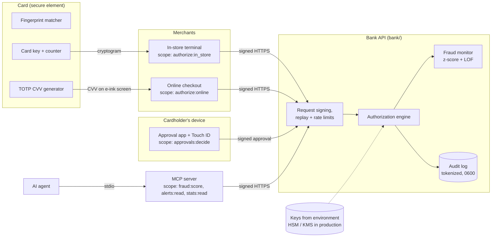
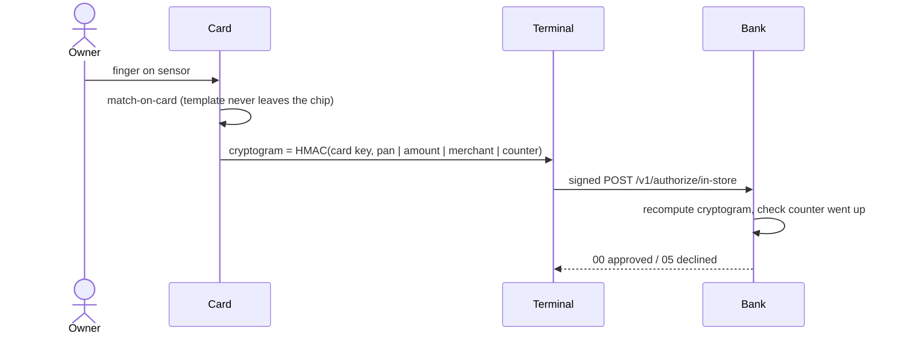
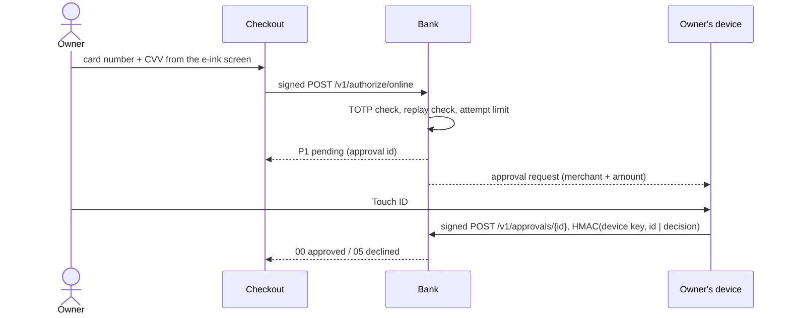

# System design

How the pieces fit together, what each one is trusted to do, and what stops each attack. The repo runs all of it locally; the last section lists what a real bank deployment would add.

## Components

| Component | Code | Trusted with |
|---|---|---|
| Card | `card_cryptogram()` in `bank/security.py`, the Streamlit app | Fingerprint template, card key, TOTP secret. Never sends the fingerprint anywhere. |
| Terminals and checkouts | API clients | Nothing secret about the card. They only see response codes. |
| Cardholder's device | `approval_signature()` | Device key. Signs "approve" or "deny" after a Touch ID check. |
| Bank API | `bank/api.py`, `bank/core.py` | Every decision. The only component that holds all keys. |
| Fraud monitor | `bank/fraud.py`, `Bank._monitor()` | Read access to the ledger. |
| MCP server | `mcp_server/server.py` | Read-only fraud credentials. Cannot move money. |

## Trust boundaries

Every arrow into the bank crosses a trust boundary, so every request is authenticated the same way:

1. **Signed requests.** Each client has its own secret and signs `method, path, timestamp, nonce, SHA-256(body)` with HMAC-SHA256. A changed amount, path or body breaks the signature.
2. **Freshness.** Requests older than 5 minutes are refused, and each nonce works once, so a captured request can't be replayed.
3. **Scopes.** Each client can only call the endpoints its job needs. A terminal can't read alerts, and the MCP server can't authorize payments.
4. **Authentication before parsing.** The body is only validated after the signature checks out, so an attacker learns nothing about the request format.

## Payment flows

### In store

A locked card produces no valid cryptogram, so a stolen card is useless. Because the amount and merchant are inside the cryptogram, a terminal can't change them, and the counter stops an old cryptogram from being reused.

### Online

The CVV changes every 2 minutes and each one works once. Three wrong CVVs pause online payments for a minute, because there are only 1,000 possible codes. Even a phished, current CVV fails without the owner's approval from their own device.

### AI agent through MCP

The agent starts the MCP server as a local process and talks to it over stdio. The server signs requests with the `fraud-agent` credentials, which only allow scoring, alerts and stats. See [MCP server security](#mcp-server-security).

## Threat model

Using STRIDE. Every row has a test in `tests/`.

| Threat | Example | Control | Test |
|---|---|---|---|
| **Spoofing** a client | Attacker calls the API as a terminal | Per-client HMAC signatures, unknown clients rejected | `test_forged_signature_is_rejected`, `test_unknown_client_is_rejected` |
| **Spoofing** the cardholder | Thief taps a stolen card | Chip only signs after a fingerprint match | `test_locked_or_cloned_card_is_declined` |
| **Spoofing** the approval | Someone else presses "approve" | Approval signed by the device key after Touch ID | `test_approval_from_another_device_is_declined` |
| **Tampering** | Terminal or proxy changes the amount | Body hash in the signature; amount inside the cryptogram | `test_tampered_body_is_rejected`, `test_terminal_cannot_change_the_amount` |
| **Replay** | Resending a captured request, cryptogram, CVV or approval | Nonces, timestamps, card counter, one-time CVV and approval ids | `test_replayed_request_is_rejected`, `test_replayed_cryptogram_is_declined`, `test_cvv_works_only_once`, `test_approval_works_only_once` |
| **Repudiation** | "I never made that payment" | Append-only audit log of every decision and failed login | `test_audit_log_has_no_card_data` |
| **Information disclosure** | Card data leaking through logs, errors or the AI agent | Tokenized card numbers, no CVVs in logs, generic errors, docs off in production, owner-only log file | `test_audit_log_has_no_card_data`, `test_errors_and_headers_reveal_nothing`, `test_output_never_contains_card_numbers` |
| **Denial of service** | Flooding the API or brute-forcing signatures | Per-client rate limit, lockout after 20 failed signatures per address, 16 KB body limit | `test_rate_limit`, `test_repeated_bad_signatures_lock_out_the_source`, `test_oversized_body_is_rejected` |
| **Elevation of privilege** | MCP server or a terminal calling endpoints outside its job | Scopes per client, MCP tools read-only | `test_client_cannot_use_another_clients_scope`, `test_server_with_payment_credentials_gets_nothing` |
| **Brute force** | Guessing the 3-digit CVV | 3 attempts, then a 60-second pause | `test_guessing_cvvs_pauses_online_payments` |
| **Injection** | Malformed or extra JSON fields, script in a merchant id | Strict Pydantic models, unknown fields rejected, merchant ids limited to `[a-z0-9-]` | `test_bad_values_are_rejected`, `test_unexpected_fields_are_rejected` |

## Key management

| Key | Held by | Purpose |
|---|---|---|
| Client secrets (one per client) | Each client and the bank | Request signatures |
| Card key | Card's secure element and the bank | In-store cryptograms |
| TOTP secret | Card and the bank | Dynamic CVV |
| Device key | Cardholder's device and the bank | Purchase approvals |
| Token key | Bank only | Tokenizing card numbers in logs and alerts |

- Keys only come from environment variables. The service refuses to start if one is missing or shorter than 32 bytes, so there is never a default key.
- `python -m bank.keys` generates a fresh set with Python's `secrets` module.
- `.env`, key files and logs are in `.gitignore`, and CI scans the whole git history for leaked secrets on every push.
- `Settings` hides keys from its `repr`, so they can't end up in a log or traceback by accident.
- To rotate, generate new keys, update the environment and restart. Old signatures stop working straight away.

## MCP server security

The MCP server is the most interesting part to secure, because whatever an AI agent can call, a prompt injection could make it call.

- **Read-only tools.** `score_transaction`, `list_fraud_alerts` and `get_payment_stats`. There is deliberately no tool that authorizes, approves or refunds anything.
- **Least privilege.** Even if the server process were compromised, its credentials can't reach the payment endpoints. The bank enforces this, not the server.
- **No network port.** stdio only, so there is nothing to attack over the network.
- **No secrets in output.** The bank never returns card numbers, CVVs or keys, so no tool can leak them.
- **Validated input.** Amount, hour, channel and limit are range-checked before any request is made.
- **Prompt injection.** Alert text comes from fixed templates, and merchant ids are restricted to `[a-z0-9-]`, so a merchant can't plant instructions for the agent inside an alert.
- **TLS for remote banks.** The client refuses to send credentials over plain HTTP to anything other than localhost.

## Deployment

- `python -m bank` binds to `127.0.0.1`. It refuses to listen on a network address unless TLS is configured (`BANK_TLS_CERT` and `BANK_TLS_KEY`) or `BANK_BEHIND_TLS_PROXY=1` confirms a TLS proxy sits in front.
- No `Server` header, plus security headers on every response (`no-store`, `nosniff`, `DENY` framing, a strict CSP and HSTS).
- API docs (`/docs`, `/openapi.json`) only exist when `BANK_ENV=dev`.
- The audit log is created with owner-only permissions (`0600`).

### CI checks (`.github/workflows/security.yml`)

| Check | Tool | Runs |
|---|---|---|
| Test suite (every attack above) | pytest | every push and pull request |
| Insecure code patterns | Bandit | every push and pull request |
| Known vulnerable dependencies | pip-audit | every push and weekly |
| Leaked secrets in the full history | gitleaks | every push and pull request |
| Dependency updates | Dependabot | weekly |

The workflow token only has read access to the repo.

## What a real bank would add

No system is unbreakable, and this is a working prototype rather than a production bank. The controls above are real and tested, but a production deployment would also need:

- **Hardware key storage.** Keys in an HSM or a cloud KMS, never in environment variables, with automatic rotation.
- **Real card cryptography.** EMV ARQC cryptograms with per-card keys derived from issuer master keys, instead of one HMAC key.
- **WebAuthn verification.** Verify the device's public-key signature (passkey assertion) server-side, instead of a shared device key.
- **Mutual TLS** between all services, on top of request signatures.
- **Shared state.** Nonces, rate limits, approvals and the ledger in an encrypted database or Redis, so they survive restarts and work across several servers.
- **PCI DSS compliance** for anything that stores or processes real card numbers.
- **Monitoring.** Audit logs shipped to a tamper-evident store and a SIEM, with alerting on authentication failures.
- **Independent testing.** Penetration tests and a security review before going live.
